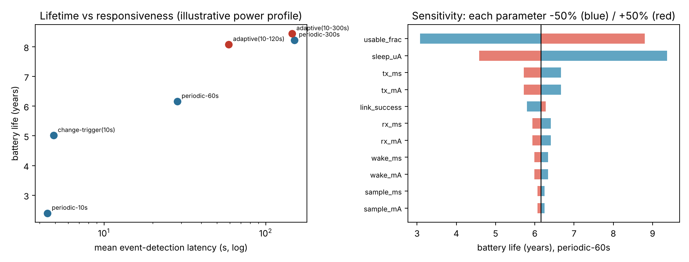
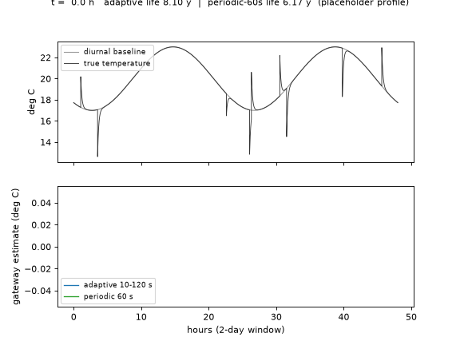

# iot-energy-lab


**Question:** for a coin-cell sensor node on a low-power wireless SoC, how much battery life does a smarter
*reporting policy* buy, and what does it cost in data quality and responsiveness? Simulation only; no hardware.

The reporting policy is **portable integer C** (`c/report_policy.c`, 218 bytes on Cortex-M33, no helper calls,
no division, no heap) that is compiled for the host, driven by a Python energy simulator over ctypes, and
cross-compiled for Cortex-M33 / M0+ / AVR to measure size. The structure follows the energy-mode thinking used by
Silicon Labs EFR32-class parts (active, sleep, deep sleep, stop, shutoff), so the same policy and model can be
re-parameterised for a Series 2 target.



> **Important:** every current/time number in `PowerProfile` is an **illustrative placeholder**, *not* a Silicon Labs
> specification. I could not verify datasheet values from this environment. Replace them with your target's datasheet
> values or energy-profiler measurements before drawing conclusions about a real product. The sensitivity analysis
> below shows which numbers matter.

## Setup
Synthetic temperature: diurnal swing + sensor noise + ~6 "door-open" events/day (step of 2-5 C decaying over ~10 min).
A node wakes, samples, optionally transmits (up to 3 retries, link success 0.9). Gateway holds the last received value.
7 simulated days x 30 seeds; battery life is extrapolated from average current (coin cell, 225 mAh x 0.7 usable).
Policies: always-transmit periodic (10/60/300 s), `change-trigger` (wake every 10 s, send on deadband), `adaptive`
(wake period 10 s when the signal moves, doubling up to 120 or 300 s when quiet; heartbeat every 600 s).

## Results (`results/summary.md`)
| policy | battery life (years) | mean error (0.01 C) | event latency (s) | TX attempts/day |
|---|---|---|---|---|
| periodic-10s | 2.40 | 4.1 | 4 | 9600 |
| periodic-60s | 6.16 | 5.1 | 28 | 1599 |
| periodic-300s | 8.23 | 10.0 | 151 | 320 |
| change-trigger(10s) | 5.01 | 8.2 | 5 | 200 |
| adaptive(10-120s) | 8.08 | 10.8 | 59 | 178 |
| adaptive(10-300s) | 8.44 | 13.6 | 146 | 165 |

1. **Transmitting less is not enough**: change-trigger sends 8x less than periodic-60s yet lives *shorter* (5.0 vs 6.2 y),
   because it still wakes and samples every 10 s. Adaptive *wake-up* scheduling is what pays.
2. **Adaptive(10-120s) lives about as long as periodic-300s (8.08 vs 8.23 y) with 2.6x lower event latency (59 vs 151 s)**;
   its mean error is similar to periodic-300s (10.8 vs 10.0 centi-deg) and about 2x that of periodic-60s (5.1).
3. **In this model sleep current and usable battery fraction dominate** (sensitivity: sleep +-50% moves periodic-60s from 9.4 to 4.6 y;
   radio current/time moves it by < 1 y). So the conclusion "wake-ups, not packets, are the cost" depends on the sleep floor
   being low; with a leaky sleep state or a much more expensive radio the ranking could change. Check with real numbers.
4. Confidence intervals are ~0 because seeds only change noise and events, not the power model; they do **not** include parameter uncertainty (see sensitivity).

## Limitations
* Placeholder power profile; no battery self-discharge, temperature, voltage droop, or radio duty-cycle/protocol details (BLE connection events, Thread parent polling, etc.).
* One synthetic signal family; event detection defined as a delivered report >= 1 C from baseline within 15 min.
* Footprint is compile-only (clang -Os, `results/footprint.csv`): 218 B (M33), 204 B (M0+), 392 B (AVR), zero library calls. No cycle counts.

## Next steps on real tooling
Port `rp_step()` into a Simplicity Studio sleeptimer/event-driven example and measure with the Energy Profiler on a dev kit; replace the profile with measured numbers.

## Reproduce
```bash
pip install numpy matplotlib pytest
PYTHONPATH=src python -m pytest -q tests        # 9 passed
python experiments/run_experiments.py           # ~40 s
python experiments/summarize.py && python experiments/make_figures.py && python experiments/measure_footprint.py
```
MIT licensed.


## Simulated animation

[](figures/demo_policy.gif)

*Adaptive vs periodic reporting over two simulated days. Regenerate with `python experiments/make_animation.py`; the frames are produced by this project's own simulator.*


## How this connects

Same embedded/resource-constrained thread as [`embedded-autonomy-sim`](https://github.com/olamida/embedded-autonomy-sim); network side is studied in [`mesh-routing-sim`](https://github.com/olamida/mesh-routing-sim).

## Portfolio documentation

- [`APP-GUIDE.md`](APP-GUIDE.md) — work executed and work still to do.
- [`USER-GUIDE.md`](USER-GUIDE.md) — end-user manual.
- [`PENDING-TASKS.md`](PENDING-TASKS.md) — AI session-continuity ledger.
- [`SYSTEM-DOCUMENTATION.md`](SYSTEM-DOCUMENTATION.md) — developer/architecture reference.
